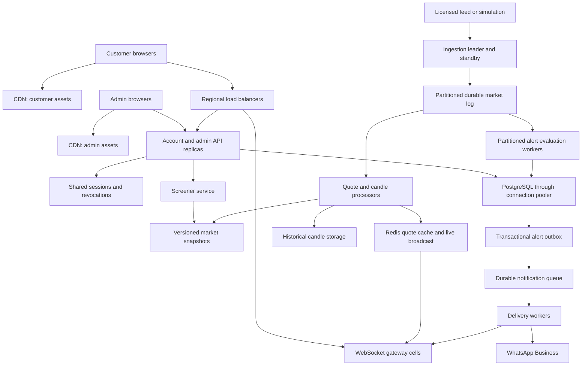

# ChartPulse: low latency and million-user architecture

Status: engineering design, not implemented or capacity certified. Prepared 10 October 2026.

## 1. Scope and measurable targets

Design first for **1,000,000 simultaneous authenticated browser connections**, then expand to 3,000,000 by adding regional gateway cells. This is a concurrency target, not a claim about the current application. Registered account count is a separate dimension. India is the primary audience; NSE/BSE data remains synthetic until licensed distribution is enabled.

Zero latency is physically impossible. Network travel, provider delays, queueing and rendering all take time. The following are proposed acceptance targets under the defined workload; they must be measured before advertising them:

| Operation | Proposed target | Measurement boundary |
|---|---|---|
| Latest quote visible in an active browser | p95 <= 500 ms; p99 <= 1 second | Receipt at our ingestion service to browser rendering, with ordinary network conditions and an active tab |
| Platform quote processing | p95 <= 100 ms | Ingestion receipt to quote available at gateway |
| Cached account/watchlist requests | p95 <= 150 ms; p99 <= 500 ms | Server receives request to server completes response; client network latency is additional |
| Common current-market screener | p95 <= 300 ms; p99 <= 1 second | Server receives bounded query to completed response |
| Technical alert created durably | p95 <= 500 ms; p99 <= 2 seconds | Receipt of qualifying input to committed alert event, within admitted rule complexity and trigger volume |
| Customer services availability | 99.95% monthly objective | Valid requests and authenticated stream connection availability, measured separately from provider freshness |

p95 means 95% of measured operations finish within the target. These are objectives, not guarantees. Report source timestamp, ingestion timestamp and rendered timestamp separately. Provider-to-platform latency is outside the internal processing budget. Missing updates and failed requests count against reliability metrics; they must not disappear from latency reports. Mobile background tabs and suspended devices cannot satisfy active rendering targets.

WhatsApp submission and handset delivery have separate metrics. External quotas, templates, provider outages and handset connectivity prevent a reliable subsecond end-to-end promise. Keep an in-app alert available even when WhatsApp is delayed.

## 2. Architecture

Live market broadcasts travel from gateway to browser over the already established socket. PostgreSQL is not queried per quote or per connected client. Administrative mutations travel through authenticated admin APIs, independent of customer chart delivery.

## 3. Technology choices

| Component | Choice | Purpose |
|---|---|---|
| Account/admin APIs | Node.js, existing Express; TypeScript for new service boundaries | Preserve existing portal features and enforce roles |
| Live gateways | Node.js with a WebSocket library, bounded buffers, one socket per tab | Subscription-based push; benchmark CPU, memory and network capacity before choosing instance sizes |
| Durable market/event log | Managed Apache Kafka, partitioned by symbol | Ordered input within a symbol, replay, separate consumer groups for processors and evaluators |
| Quote cache and broadcast | Sharded Redis-compatible service | Latest snapshots, subscription distribution, short-lived caches |
| Sessions | Separate customer/admin sessions in a shared session store | Existing separation persists across API replicas |
| Accounts, preferences and durable alerts | Managed PostgreSQL + connection pooler | Durable ownership, transactions, outbox and delivery status |
| Historical candles | Initially partitioned PostgreSQL; object storage for archive | Avoid repeated history downloads and unbounded hot tables; add an analytical store only if measurements require it |
| Screener engine | Dedicated snapshot/worker service | Evaluate approved query grammar over a shared market snapshot |
| Delivery queue | Durable, separately provisioned Redis Streams for launch, with acknowledged consumers | Isolate outbound provider delays from charts; retention and persistence sized for outage recovery |
| Monitoring | OpenTelemetry traces and metrics plus dashboards/alerts | Measure freshness, queue lag, event-loop delay, errors and customer-visible latency |
| Frontend | Preserve customer/admin apps; use incremental Canvas chart updates | A frontend framework change is not a prerequisite for concurrency |

Durable Kafka storage and the notification queue must have replication, retention policies and operational owners. A single cache server or a single broker is not the proposed million-user deployment. Keep sessions and durable queues separate from evictable quote caches.

Redis Pub/Sub does not retain messages for disconnected subscribers. Use it only for replaceable live snapshots; rebuild from latest state/history after interruption. Alert inputs and notification work use durable logs/queues, acknowledged processing and idempotency. Redis Streams consumers can receive work again, so delivery workers must tolerate redelivery. [Redis streaming documentation](https://redis.io/docs/latest/develop/use-cases/streaming/)

## 4. Live quote and chart path

1. One active licensed ingestion leader owns each provider feed, with a standby and a fencing epoch. Replicating API servers must not open their own provider feeds. Partition ownership follows provider entitlements and subscription limits.
2. Validate and normalize timestamps, symbols, provider sequence numbers and duplicate events. Detect missing sequences; request recovery when the provider supports it. Mark disconnected/stale feeds explicitly.
3. Append accepted input to the durable market log with the configured replication acknowledgement policy. Acknowledge our own HTTP event intake only after durable admission. Upstream WebSocket feeds may not support acknowledgements; a broker outage cannot be described as lossless unless upstream recovery exists.
4. Quote/candle processors consume each symbol partition in order. Cache the latest quote and build candles once for each supported interval. Share calculations between all users with the same indicator parameters.
5. Gateways subscribe only to broadcast shards needed by their local clients. Distribute popular symbols across gateway cells so one popular stock cannot saturate one gateway.
6. Send changed values in bounded batches, initially at most four quote batches per second per active tab. A batch contains its symbol changes, timestamps, source epoch and sequence. The server controls batch limits; subscription changes are rate limited.
7. Customers receive an authorized initial snapshot and cached history, then incremental updates. On sequence/epoch discontinuity or reconnect, obtain a fresh snapshot and refill candle gaps. Intermediate ticks may be skipped for display, but never claim that the display stream is a complete tick record.
8. Render at the next animation frame; update the current candle rather than rebuilding the entire chart or downloading all candles every three seconds. Hidden tabs reduce subscriptions/update rate and resynchronize on resume.

Sequence numbers must be scoped to a symbol/stream and source epoch. Reconnect with exponential backoff and jitter, periodic ping/pong, bounded authorization checks and a fresh subscription snapshot. Avoid sending bearer credentials in URLs. Use short-lived single-use socket tickets issued by the customer API when sockets use a separate hostname.

For slow clients, coalesce replaceable quote updates to the latest value. Bound outbound bytes, subscription count and pending work. Disconnect and resynchronize clients that exceed the buffer budget. Durable alert notifications have event IDs and history access; they are not silently discarded with quote updates.

## 5. Screener and alert processing

### Screener

- Keep the approved numeric query grammar; do not execute arbitrary user code or SQL.
- Use immutable market snapshot versions. Every result identifies the snapshot and its freshness.
- Normalize identical queries and share result caches by market/entitlement/snapshot. Do not cache account-private filters under public keys.
- Update common indexes for price, percent change, volume and indicator fields. Evaluate a query once per changed snapshot or relevant symbol, not once per connected user.
- Bound syntax size, symbol universe, historical lookback and CPU time. Common current-market queries run synchronously; expensive history scans become cancellable background jobs with progress.
- Client query-as-you-type is debounced. Dashboard refresh requests subscribe to result updates instead of repeated full-universe scans.

### Alerts

- Evaluate the durable, ordered input stream before chart coalescing. Brief price crossings must not vanish because chart delivery skips intermediate updates.
- Partition state by symbol and rule ID. Index thresholds and share common indicator calculations; update only affected rules. Popular symbols and identical rules need dedicated capacity and shared predicate evaluation.
- Query-based alerts maintain incremental matching sets over consistent snapshots. Multi-symbol rules use snapshot/bar watermarks instead of treating unrelated symbol arrival times as one simultaneous market state.
- Persist an alert event and its outbox record in the same transaction. Use a unique logical event key based on rule/version, triggering source event or completed bar, and configured frequency. Worker retries must not create duplicate events.
- Persist checkpoints and rule state. Recover the last committed checkpoint after failure; fencing prevents two owners from committing conflicting state. Define creation/update activation positions so replay does not unexpectedly trigger pre-existing historical crossings.
- Notification workers claim outbox work safely, honor per-provider/account quotas, retry with backoff and send exhausted failures to a dead-letter workflow. Ambiguous external send outcomes require reconciliation where supported. Exactly-once WhatsApp delivery is not guaranteed.
- Measure burst alert volume independently of connected users. A market shock can trigger millions of alerts; admission quotas, reserved evaluator capacity and durable backlog controls must be part of the offered service tier.

## 6. Concurrency and bandwidth budget

Sizing assumptions below are illustrations for planning, not benchmark results:

| Workload dimension | Initial design envelope |
|---|---|
| Simultaneous authenticated tabs | 1,000,000 |
| API load separate from streaming | 10,000 requests/second steady; 30,000/second burst |
| Subscribed symbols | Up to 50 per tab; representative average 10 |
| Chart intervals | Existing bounded interval set; history capped/paginated |
| Client update frequency | At most 4 batches/second for active tabs |
| Candidate live rules | Average 10/customer; profile worst-case symbol concentration separately |
| Initial market intake test | 10,000 ticks/second steady and 100,000/second burst, synthetic until a provider profile is known |

The subscription count does not imply sending every tick for every symbol. The measured batch payload must include all changed subscribed symbols. Full-universe broadcasting to every browser is prohibited.

**Example egress:** if each client receives four batches/second averaging 200 bytes each, one million clients require 800 MB/second payload throughput, approximately 6.4 Gbit/second and 2.88 TB/hour. TLS, protocol overhead, historical downloads and larger watchlist batches add traffic. At a 2,000-byte average batch, this becomes 8 GB/second. Three million clients multiply those totals by three. This is why payload profiling, subscriptions and egress budget matter as much as server CPU.

**Example gateway fleet:** assume a load test certifies 10,000 connections per gateway at the target message profile. Operating at 70% of that capacity gives about 143 gateways for one million connections and 429 for three million, before allowing for cell failure. If the measured limit is lower, more gateways are required. If higher, fewer may suffice. File descriptor limits, load balancer capacity, TLS, garbage collection, network throughput and client buffer sizes must all be included.

At a hypothetical 100 KiB of total memory per connection, one million connections alone use roughly 95 GiB across the fleet, before shared caches and operational headroom. Actual memory per connection must be measured.

Peak connections, ticks/second, unique rules, active trigger volume, query complexity and payload bytes are independent capacity inputs. No single user-count figure certifies all of them.

## 7. Deployment and regional strategy

### Render launch path

Keep Render as the launch platform, using paid services in one region for APIs, gateway cells, dedicated ingestion, processors, alert evaluators and notification workers. Serve immutable portal assets through CDN-backed static hosting. Use shared managed datastores and an external managed durable broker if necessary. Current Render documentation lists Singapore as its Asia region; choose it for initial India-focused evaluation and measure Indian ISP round-trip times. Render currently does not list an India region. [Render regions](https://render.com/docs/regions)

Render supports WebSockets and multiple service instances. Its documented scaling limits are plan dependent; paid plans up to 8c-32g currently allow up to 100 instances per service, with lower limits for larger plans. The illustrative gateway fleet above may therefore need multiple gateway services/cells, increased platform limits and confirmed load-balancing/egress capacity. Agree the connection, bandwidth and failover envelope with Render before committing to a million-user service. CPU/memory autoscaling alone does not measure socket or network saturation. [Render scaling](https://render.com/docs/scaling), [Render WebSockets](https://render.com/docs/websocket)

Do not interpret a Render YAML deployment as performance certification. Free plans are not the million-user configuration. Keep transport and queue interfaces portable so gateway cells can be moved to an India-region managed container platform if measured latency, cost or Render capacity warrants it. Co-locate broker, cache, processors and database with their critical callers; cross-region synchronous database trips undermine the latency goal.

### Regional expansion

Use one authoritative write/alert evaluation region first, with a warm disaster-recovery region. Regional edge gateways can serve local authorized quote caches when licensed distribution permits it. Do not run independent active alert writers against the same rules. Failover requires a new fencing epoch, durable checkpoint recovery and explicit source-gap reconciliation.

Account writes initially route to their authoritative region. Introduce account-based write sharding only when measurements justify the added complexity. Quote data is shared market information; account data and alert ownership remain isolated. Confirm licensed data display rights for each region and user tier.

Pre-scale ahead of market open and known announcements. Maintain spare cells, drain connections on rollout, and reconnect clients with jitter. Scale on active sockets, network bytes, outbound buffer size, event-loop delay, Kafka lag, worker queue age and database saturation in addition to CPU/memory.

## 8. Persistence, authorization and failure behavior

- Shared customer/admin sessions retain distinct cookie names and role checks. Session storage is independent of gateway process memory.
- Cache account status with bounded TTL and versioned invalidation. A pause/logout event revokes socket tickets and disconnects affected sockets; sensitive admin mutations require fresh authorization. Define and measure a revocation propagation objective rather than assuming a cache is always current.
- Apply origin checks to socket upgrades, CSRF protection to cookie-authenticated mutations, tenant ownership checks and separate admin limits. Never place private alerts on public quote channels.
- PostgreSQL uses a connection pooler and a fleet-wide connection budget. Do not allocate a database connection per socket. More max_connections is not a substitute for capacity planning. [PostgreSQL connection documentation](https://www.postgresql.org/docs/current/runtime-config-connection.html)
- Partition growing candle/event tables, index ownership/time access, paginate customer lists and alert history, and move old records to archive according to an explicit retention policy.
- Database failures pause durable alert commits and account writes; consumers retain/replay admitted events within the recovery retention window. Quotes can continue from a healthy live path with accurate status; cached authorization cannot grant new access indefinitely.
- Cache/broadcast failures disconnect or resynchronize gateways; never label an old price live. Broker/provider failures expose stale timestamps and gaps. Define when alert evaluation must pause instead of acting on uncertain input.
- Separate synthetic and licensed feeds with environment/source namespaces, event epochs and explicit frontend labels. Synthetic mode must never submit real WhatsApp messages.
- Backups, restore drills and managed failover are required. Suggested initial disaster-recovery objectives are RPO <= 1 minute and RTO <= 15 minutes, subject to actual cross-region replication and provider recovery. These are separate from same-region redundancy and not yet validated.

## 9. Migration from the current application

| Step | Concrete change | Acceptance gate |
|---|---|---|
| 1 | Add telemetry, request budgets, pagination, indexes and representative traffic profiles | Baseline p95/p99, CPU, bandwidth, query plans and event freshness documented |
| 2 | Extract provider/simulation ownership from server.js into ingestion; move queue/evaluation timers into workers | Three API replicas create no duplicate feeds or alerts; simulation is one shared clock |
| 3 | Add durable market log, outbox and delivery worker ownership | Replay and crash recovery produce consistent alert events; ambiguous delivery outcomes documented |
| 4 | Add quote/candle cache, authorized WebSocket gateway and frontend delta updates | Remove 3-second chart polling; reconnect, gap repair, stale data and slow client handling work |
| 5 | Extract screener snapshots and shared technical calculations | Matching results retain snapshot consistency and private ownership under concurrent edits |
| 6 | Introduce multiple gateway cells, shared sessions and pooler connection budgets | Rolling deployment and role revocation work without per-instance session dependence |
| 7 | Run staged external load and failure exercises | Verified gates at 10k, 100k, 500k and 1m connections before admitting each scale |
| 8 | Expand to 3m with regional cells and a tested disaster-recovery procedure | Repeat full workload gates, including regional failure and provider gaps |

The current monolith, free Render blueprint, local PGlite database and HTTP polling remain unchanged by this document. This design is the specification for their migration; it does not install or deploy the distributed architecture.

## 10. Capacity acceptance plan

This document defines future tests; none were run for this design request.

Use many external load generators from representative Indian networks/regions. A single laptop cannot certify a million sockets. Include connection ramp-up, sustained traffic, market open bursts, repeated reconnect storms, a popular-symbol hotspot, chart history requests, complex screeners, rule edits and a market-wide alert burst.

At each scale gate:

1. Sustain the agreed mix for at least two hours; use an extended soak at the final target.
2. Record end-to-end quote freshness, all target p95/p99 metrics, failures, dropped/coalesced display updates and durable-input gaps.
3. Kill a gateway, restart evaluator workers, interrupt a broker/cache node, exercise database failover and throttle the WhatsApp provider. Verify controlled recovery and idempotent alert events.
4. Demonstrate bounded buffers, no memory growth, no uncontrolled retry storms and at least the agreed capacity reserve.
5. Publish tested instance counts, broker/queue retention, payload sizes, cost per connected-user-hour and the admitted limits for subscriptions, rules and historical queries.

Do not advertise million-user capacity until this workload passes. If latency breaches its objective, limit admission or reduce optional display update rates with visible status; preserve durable evaluation and account isolation.

## 11. Commercial and launch decisions

The target workload requires a paid infrastructure budget, provider redistribution rights, an agreed maximum alert burst and a WhatsApp throughput plan. Exact monthly cost cannot be responsibly stated from user count alone: egress volume and active hours may dominate.

Before provisioning, finalize concurrent tabs versus people, regional distribution, subscriptions and payload profile, maximum rules/customer, quote freshness tier, burst alerts/second, event retention and availability budget. The design's initial assumptions allow development to proceed without pretending those decisions are already measured.

### References

- [Render service scaling](https://render.com/docs/scaling)
- [Render regions](https://render.com/docs/regions)
- [Render WebSockets](https://render.com/docs/websocket)
- [Render background workers](https://render.com/docs/background-workers)
- [Redis streaming and consumer groups](https://redis.io/docs/latest/develop/use-cases/streaming/)
- [PostgreSQL connection configuration](https://www.postgresql.org/docs/current/runtime-config-connection.html)
- [Apache Kafka documentation](https://kafka.apache.org/documentation/)
